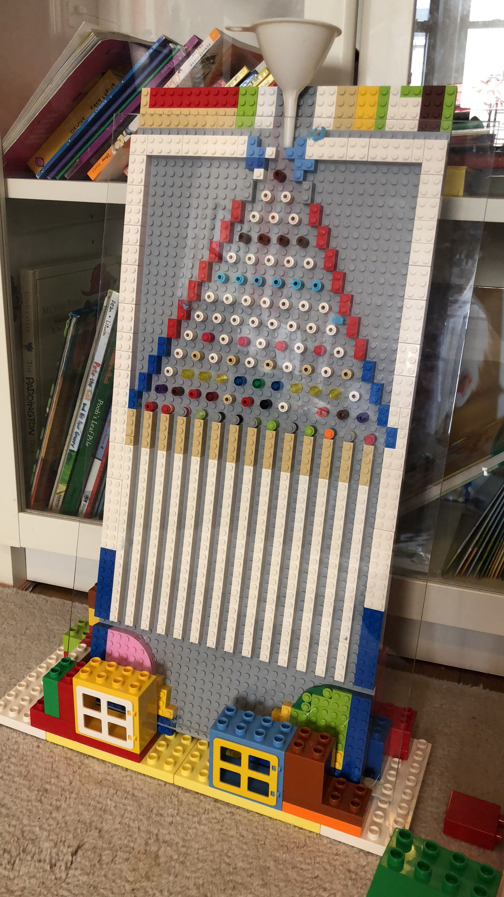

Over the weekend some biostatistics and statistics colleagues of mine at Columbia University took on the challenge of making Data Science fun for Elementary School Children (K-6).

We had:

-   Games of chance with a dice game and a Galton board

{width=300}

-   Data visualization: [https://www.showmeshiny.com](https://www.showmeshiny.com/)
-   [Chernoff faces](https://flowingdata.com/2010/08/31/how-to-visualize-data-with-cartoonish-faces/) as a descriptive tool for summarizing/clustering similar multivariate data. We collected survey data on questions kids developed (e.g. what subject do you like in school, do you prefer white or chocolate milk) and then summarized and clustered it.
-   A Mock Clinical Trial: The results confirmed that reading about eating healthy fruits does not make kids less likely to choose candy! [Download the PowerPoint](/wp-content/uploads/2018/04/TSC-Data-Science-Expo-2018-Clinical-Trials-short-updated.pptx)
