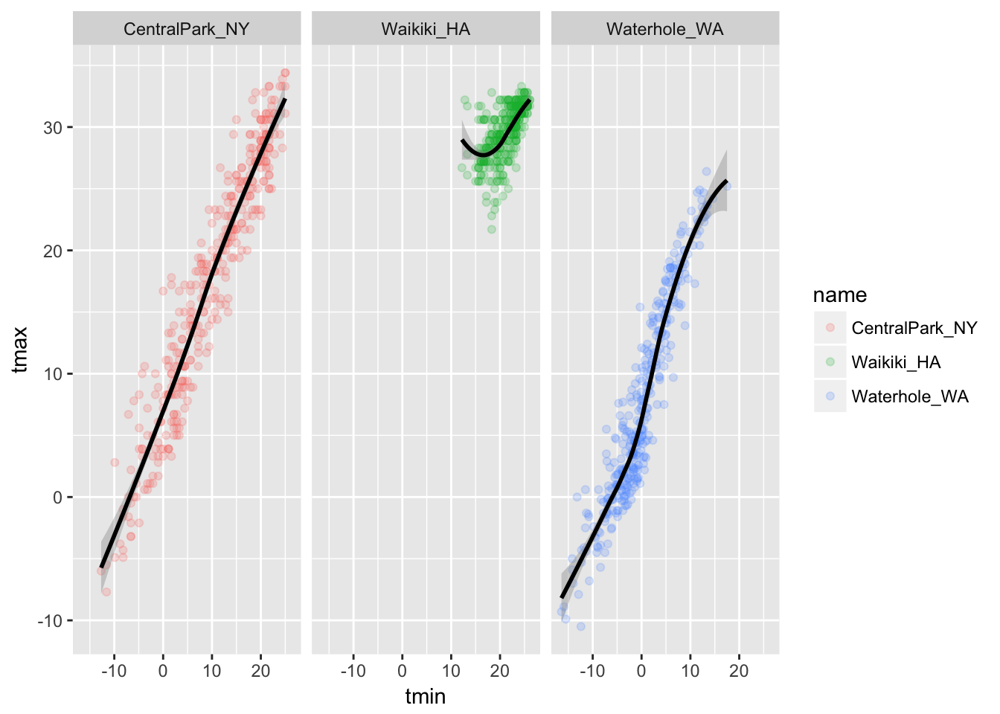

This past week, Monday- Friday for 2 hours every day, my colleague Jeff Goldsmith held a CRASH COURSE in R TIDYVERSE for \~10 faculty in Mental Health Data Science and Biostatistics who are all (cough) over 30 years old (ok maybe over 50).  Some of us on the upper tail of that age distribution remember when R began in the 90's and was the next best thing after S+, but that is ancient history.

Jeff went through most of his semester course notes (<http://www.p8105.com/>) for us.  Just for posterity I list here all the things I had no clue about before Monday and now think I will be using as much as possible, also some analogies to SAS which helped me understand better:

1.  RStudio (like the SAS editor, log and output window, but fancier)
2.  R Markdown documentation (maybe I will eventually relent and agree to use html with colleagues) and "knitting"
3.  Tibbles (the new name for data frames), read_csv (instead of read.csv, oh so easy), haven::read_sas
4.  How to manipulate datasets ("tibbles") using the tidyverse (which is the name of the 'revolutionary' R package which has transformed data analysis pipelines with R and embraces the reproducible transparent science movement) using: select (to choose variables), filter (to choose rows), mutate (to derive new variables), arrange (to sort).  This set of tools are what I see as being the major advances in R that now makes it at the same level or surpassing  SAS for manipulating data (something I used to believe R was not at all good for and probably the main limitation that kept me from using it)
5.  Using the pipe %\>% rather than nested functions so that code is cleaner and more transparent
6.  Merging data using full_join() and left_join(), I was shocked when I found out we don't have to sort the data first
7.  How to transpose from wide to long and vice versa using `gather()` and `spread()`. Found that this was as non-intuitive as SAS Proc Transpose, but not worse.
8.  Using the broom::tidy() to create tibbles from model output.  This is like the ODS in SAS where everything that runs out of a model can be used as a dataset and thus #4 applied.
9.  GGPLOT finally I can make sense of the code (I had seen it in the past with the + signs everywhere and couldn't understand)...aes() sets up the overall aesthetics including what will be on the x vs y axis and what to plot "by" (below name is the grouping variable indicating which park the data is from) and geom_point tells ggplot you want a scatterplot (alpha is the transparency of the points), geom_smooth is obvious but (aes(color = NULL) in this layer tells it to forget the original colors), facet_grid is how to get the three different plots rather than all of them overlayed.

``` r
weather %>%
  ggplot(aes(x = tmin, y = tmax, color=name)) + 
  geom_point(alpha = .2) +
  geom_smooth(aes(color = NULL),method = "loess", color="Black") + 
  facet_grid(. ~ name)
```

{fig-alt="Scatterplots of daily minimum vs maximum temperature with a smooth curve, one panel per weather station"}

10. How to reorder factors (notice it is an anagram of factors): `forcats::fct_reorder()`

11. How to use the group_by command to do data manipulation within groups and also sending to the summarize command.  When you use the group_by command in defining a new tibble, it "sticks" to the tibble as meta information until you "ungroup" it later.

12. What Git and GitHub are though I can't say I fully figured out how to set it up yet

13. And a whole lot more that I'm sure I don't remember but now know where to go to find out 🙂

My goal is that I will be making posts soon using R markdown 🙂
